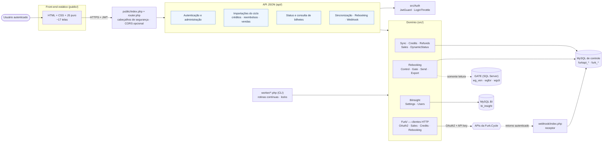
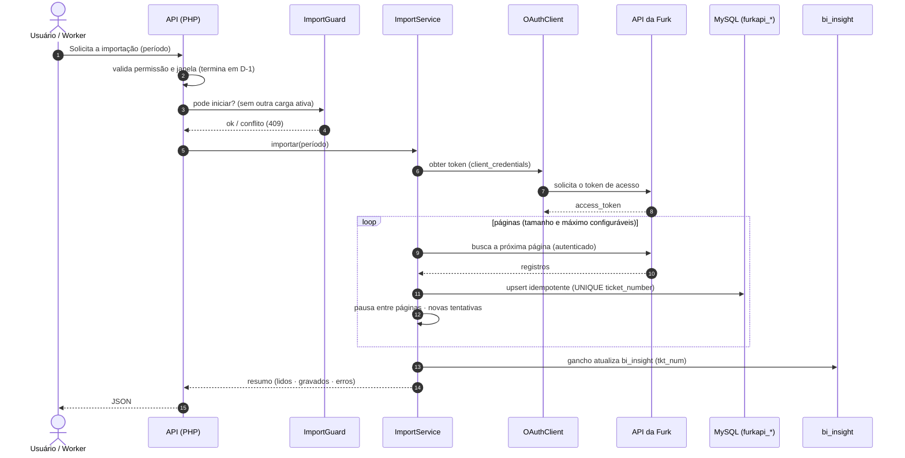
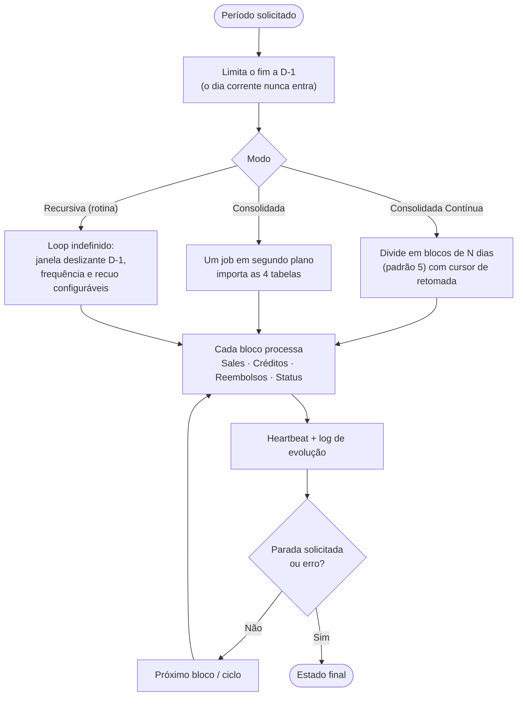
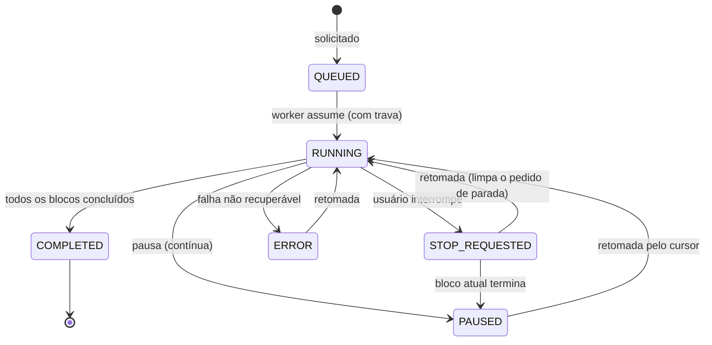
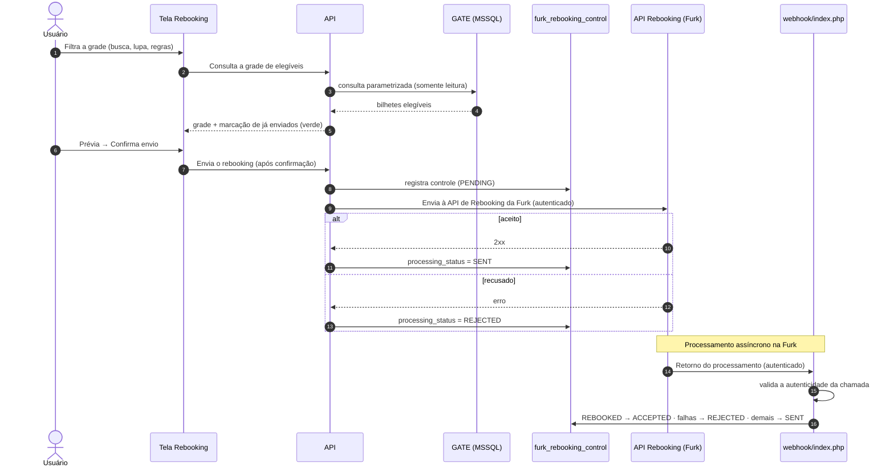
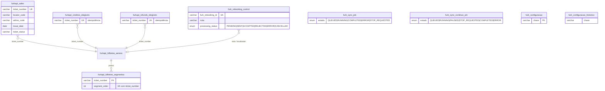

# Furk Cycle — Hub de integração do operacional de bilhetes com a Furk.Cycle


-CC2927?logo=microsoftsqlserver&logoColor=white)


> **🤖 Desenvolvimento assistido por IA — Claude Sonnet 5.5.** Este projeto foi desenvolvido com o **Claude Sonnet 5.5** (Anthropic) como agente de desenvolvimento assistido, sob orientação, requisitos e revisão de um desenvolvedor humano. A mesma IA preparou esta versão pública (sanitização, revisão de segurança estática e documentação). Detalhes na seção [Desenvolvimento assistido por IA](#17-desenvolvimento-assistido-por-ia).

> **Repositório de demonstração (vitrine).** Credenciais, hosts, dados reais de bilhetes e passageiros, bibliotecas de terceiros (`vendor/`) e arquivos de infraestrutura foram removidos ou substituídos por placeholders. O código serve para avaliação de estrutura e qualidade; veja [SECURITY.md](SECURITY.md) e [LICENSE](LICENSE).

---

## Sumário

1. [O que é](#1-o-que-é)
2. [Problema e solução](#2-problema-e-solução)
3. [Arquitetura](#3-arquitetura)
4. [Fluxo de importação](#4-fluxo-de-importação)
5. [Sincronização consolidada e rotinas](#5-sincronização-consolidada-e-rotinas)
6. [Rebooking e webhook](#6-rebooking-e-webhook)
7. [Modelo de dados](#7-modelo-de-dados)
8. [API](#8-api)
9. [Telas](#9-telas)
10. [Regras de negócio](#10-regras-de-negócio)
11. [Segurança](#11-segurança)
12. [Configuração e instalação](#12-configuração-e-instalação)
13. [Estrutura do projeto](#13-estrutura-do-projeto)
14. [Qualidade e testes](#14-qualidade-e-testes)
15. [Decisões de projeto](#15-decisões-de-projeto)
16. [Limitações conhecidas e próximos passos](#16-limitações-conhecidas-e-próximos-passos)
17. [Desenvolvimento assistido por IA](#17-desenvolvimento-assistido-por-ia)
18. [Contato](#18-contato)

---

## 1. O que é

O **Furk Cycle** é uma aplicação web que **integra o operacional de bilhetes ao ciclo de vida da Furk.Cycle**: acompanha **créditos**, **reembolsos**, **vendas**, **status de bilhetes**, **rebookings** e os **retornos por webhook**.

A aplicação **não substitui o operacional**. Ela lê os dados da Furk (e do **GATE**, no caso do Rebooking), grava em tabelas locais de controle e mantém espelhada a tabela de BI `bi_insight`.

> **Em uma frase:** um hub que importa o ciclo da Furk para o seu banco, consolida o BI e apoia a operação de Rebooking.

## 2. Problema e solução

| Desafio | Como o Furk Cycle resolve |
|---|---|
| Dados do ciclo (créditos, reembolsos, vendas, status) ficam apenas na plataforma externa | Importação periódica para tabelas locais `furkapi_*`, por *upsert* idempotente |
| Relatórios de BI dependem de dados consolidados | A tabela `bi_insight` é atualizada automaticamente por ganchos (*hooks*) a cada importação |
| A Furk só disponibiliza até o dia anterior (**D-1**) | Todas as janelas de leitura terminam em D-1; o dia corrente nunca entra |
| Povoar longos períodos (ex.: um ano) é demorado | Sincronização em blocos, com cursor de retomada e processamento em segundo plano |
| Manter os dados atualizados sem intervenção | Rotinas contínuas (*workers*) com janela deslizante |
| Rebooking é uma operação financeira e assíncrona | Prévia obrigatória, confirmação, controle de envios e retorno por webhook |
| Execuções concorrentes corrompem importações | Travas (*locks*), `ImportGuard` e estados de job (`QUEUED`, `RUNNING`...) |

## 3. Arquitetura

Aplicação em camadas, em **PHP puro** (sem framework), com roteamento próprio, serviços de domínio em `src/`, clientes HTTP isolados para a API da Furk e *workers* de linha de comando para as rotinas.



| Camada | Pasta | Responsabilidade |
|---|---|---|
| Apresentação | `public/` | Telas estáticas; consomem a API por `fetch` com token JWT |
| Entrada | `public/index.php`, `router.php` | Roteamento, cabeçalhos de segurança, CORS por lista de origens |
| API | `api/` | Validação, autorização por perfil, orquestração |
| Domínio | `src/` | Regras de negócio e repositórios (PDO), reutilizados por API e *workers* |
| Integração | `src/Furk/` | Clientes HTTP: OAuth2, Sales, Créditos, Reembolsos, Status Dinâmicos, Rebooking |
| Processamento | `worker/` | Rotinas contínuas em CLI, com trava de execução |
| Webhook | `webhook/` | Receptor dos retornos de status do Rebooking (configuração fora da pasta pública) |

## 4. Fluxo de importação

Todas as importações (créditos, reembolsos, vendas, status dinâmicos) seguem o mesmo padrão: **leitura externa → escrita interna → espelho do BI**.



As reexecuções são **idempotentes**: a importação **não apaga** dados fora do período tratado.

## 5. Sincronização consolidada e rotinas

A **Sincronização Consolidada** importa as 4 tabelas de dados (Sales, Créditos, Reembolsos e Status Dinâmicos) para um período, **em segundo plano**. Para períodos longos há a versão **Contínua** (em blocos) e a **Recursiva** (loop automático com janela deslizante).



**Estados de um job de sincronização**



Os *workers* usam **travas de execução** (`flock` e controle em banco) para impedir duas execuções simultâneas e um **heartbeat** para detectar cargas travadas.

## 6. Rebooking e webhook

O **Rebooking** lê os bilhetes elegíveis no **GATE** (SQL Server, somente leitura), permite **prévia**, **envio à Furk** (com confirmação) e **exportação em XLSX**. O resultado é assíncrono e volta por **webhook**.



**Mapeamento do retorno do webhook**

| Status devolvido pela Furk | `processing_status` gravado |
|---|---|
| `REBOOKED` | `ACCEPTED` |
| `NOT_REBOOKED`, `ERROR_REBOOKING`, `REBOOKING_DENIED`, `EXPIRED`, `CANCELLATION_DENIED` | `REJECTED` |
| Qualquer outro | `SENT` (continua aguardando) |

> O Rebooking é uma **operação financeira**: a interface exige **prévia antes do envio real**.

## 7. Modelo de dados

Dois grupos de tabelas MySQL: **dados da Furk** (`furkapi_*`) e **controle operacional** (`furk_*`).



As ligações acima são **lógicas** (por `ticket_number`), sem chaves estrangeiras no banco. A chave de idempotência de cada importação é o **`ticket_number`** (e `ticket_number + segment_order` nos segmentos). Os scripts em [`database/`](database/) são numerados (`001` a `013`) e aplicáveis em sequência.

> As tabelas contêm dados de passageiros e bilhetes (**dado pessoal — LGPD**). Nenhum dado real faz parte deste repositório.

## 8. API

A aplicação possui uma **API interna de uso restrito**: ela atende exclusivamente ao front-end da própria aplicação e a rotinas autorizadas, e **exige autenticação** em todas as operações.

Por ser uma interface destinada aos clientes da Furk, **rotas, métodos e perfis de acesso não são detalhados nesta vitrine**. Em linhas gerais, a API cobre as áreas funcionais descritas neste documento: autenticação, importações do ciclo (créditos, reembolsos, vendas e status de bilhetes), sincronizações, Rebooking, monitor de webhook e administração.

A documentação detalhada é disponibilizada somente aos clientes, mediante solicitação.

## 9. Telas

| Grupo | Telas |
|---|---|
| **Operação** | Créditos elegíveis · Status Dinâmicos (Consulta localizador, Leitura, Rotina Contínua) · Reembolsos elegíveis · Sales (Leitura, Rotina Contínua) |
| **Sincronização** | Consolidada · Consolidada Contínua · Consolidada Contínua Recursiva |
| **Rebooking e Webhook** | Grade do GATE com lupa e filtros, prévia, envio e exportação XLSX · Monitor do webhook |
| **Administração** | Usuários · Configurações · Auditoria (em desenvolvimento) |
| **Ajuda** | Guia do usuário (`public/guia.html`) |

## 10. Regras de negócio

- **D-1:** a Furk não contempla o dia corrente. Toda janela de leitura termina em **ontem**; períodos no futuro são recusados.
- **Idempotência:** reexecutar uma importação não duplica nem apaga dados fora do período.
- **Uma carga ativa por vez:** o `ImportGuard` impede cargas concorrentes e orienta o usuário quando há uma rotina em andamento.
- **Espelho do BI:** ao importar, a `bi_insight` é atualizada por ganchos (chave `tkt_num`), incluindo valores estimados de crédito e reembolso.
- **Rebooking exige prévia** antes do envio real e **marca em verde** o que já foi enviado.
- **Retorno assíncrono:** o estado do Rebooking só muda para `ACCEPTED` quando a Furk confirma por webhook.
- **Fonte do Rebooking configurável:** leitura interna (padrão, com regras da tela de Configurações) ou por *view* do GATE (rollback).

## 11. Segurança

Resumo dos controles (detalhes em [SECURITY.md](SECURITY.md)):

| Tema | Controle |
|---|---|
| Autenticação | JWT HS256 com **algoritmo fixo**, `iss` validado, `exp` obrigatório e `sub`/`role` exigidos |
| Autorização | Controle de acesso por perfil de usuário em todas as operações |
| Senhas | `password_hash` / `password_verify` |
| Força bruta | `LoginThrottle` por e-mail e por IP, com bloqueio temporário; falha aberta se o armazenamento estiver indisponível |
| SQL | *Prepared statements*; identificadores dinâmicos validados por regex; `LIMIT` limitado por inteiro |
| Webhook | Chamadas autenticadas; configuração **fora** da pasta pública |
| Transporte | `CURLOPT_SSL_VERIFYPEER=true` e `VERIFYHOST=2` em todos os clientes |
| Navegador | `X-Content-Type-Options`, `X-Frame-Options: DENY`, `Referrer-Policy`, `Permissions-Policy`; CORS **desligado** por padrão, com lista de origens |
| Erros | `display_errors` somente com `APP_DEBUG=true` |
| Segredos | Somente em variáveis de ambiente; `.env` e arquivos de infraestrutura fora do repositório |

> **Transparência:** a revisão de segurança desta vitrine foi **estática** (análise de código e busca de segredos). Não substitui um teste de invasão nem uma auditoria de dependências (`composer audit`).

## 12. Configuração e instalação

**Requisitos:** PHP 8.1+ (testado em 8.2), `pdo_mysql`, `curl`, `json`; opcionalmente `pdo_sqlsrv` ou ODBC para o GATE; MySQL/MariaDB.

```bash
composer install
cp .env.example .env            # preencha no servidor (NUNCA versione o .env)
# aplique os scripts de database/ em ordem (001 → 013)
# webhook: copie webhook/furk-webhook-config.example.php para FORA da pasta pública
# agende os workers (Windows: worker/agendar_sales_rotina.ps1 · Linux: cron)
```

**Variáveis de ambiente** (modelo em [`.env.example`](.env.example)):

| Grupo | Variáveis |
|---|---|
| Aplicação | `APP_ENV`, `APP_DEBUG`, `APP_TIMEZONE`, `APP_URL`, `CORS_ALLOWED_ORIGINS` |
| Autenticação | `JWT_SECRET`, `JWT_ISSUER`, `JWT_EXPIRATION_SECONDS`, `LOGIN_MAX_ATTEMPTS`, `LOGIN_MAX_ATTEMPTS_PER_IP`, `LOGIN_LOCK_MINUTES` |
| MySQL | `MYSQL_*` (controle) e `FOREIGN_DB_*` (banco de BI) |
| GATE (MSSQL) | `GATE_DB_*`, `GATE_REBOOKING_FONTE`, `GATE_REBOOKING_VIEW` |
| Furk | `FURK_CLIENT_ID`, `FURK_CLIENT_SECRET`, `FURK_API_KEY`, `FURK_*_URL`, `FURK_*_SCOPE`, `FURK_WEBHOOK_*` |
| Operação | `FURK_*_PAGE_SIZE`, `*_MAX_PAGES`, `*_DELAY_MS`, `*_MAX_RETRIES`, `*_TIMEOUT_SECONDS`, `SYNC_JOB_BLOCK_DAYS` |

Gere um `JWT_SECRET` forte com `openssl rand -hex 64`.

## 13. Estrutura do projeto

```text
furk-cycle/
├── api/                          # API interna (uso restrito)
├── src/                          # Domínio (namespace FurkiCycle\, PSR-4)
│   ├── Auth/                     # JwtGuard · LoginThrottle
│   ├── Config/ · Database/ · Http/ · Support/
│   ├── Furk/                     # clientes HTTP (OAuth2, Sales, Credits, Refund, Rebooking...)
│   ├── Sync/ · Credits/ · Refunds/ · Sales/ · DynamicStatus/
│   ├── Rebooking/ · Webhook/ · BiInsight/ · Settings/ · Users/ · Locator/
├── worker/                       # Rotinas contínuas (CLI)
├── database/                     # Scripts SQL numerados (001–013)
├── public/                       # Front-end (HTML/CSS/JS) e roteador
├── webhook/                      # Receptor de callbacks + exemplo de configuração
├── tools/                        # Scripts de validação (concorrência, hardening, GATE...)
├── composer.json
└── .env.example                  # Modelo de variáveis de ambiente
```

## 14. Qualidade e testes

O projeto traz **scripts de validação executáveis** em [`tools/`](tools/), sem depender de framework de testes. Eles usam um **MySQL de teste** (modelo em [`.env.test.example`](.env.test.example)) e **recusam** qualquer banco cujo nome não contenha `test`:

| Script | O que valida |
|---|---|
| `validar_hardening.php` | JWT (assinatura, `iss`, `exp`), bloqueio de login por e-mail e por IP, falha aberta |
| `validar_concorrencia.php` | Regra "a Recursiva manda" e exclusão entre cargas (`ImportGuard`) contra um MySQL de **teste** |
| `validar_http_concorrencia.php` | Comportamento da aplicação sob requisições concorrentes, com o servidor embutido do PHP e banco de teste |
| `validar_workers_sem_lock.php` | Workers disparados a cada minuto **não** seguram o lock quando não há trabalho |
| `validar_consolidada.php`, `validar_leitura_manual.php` | Fila e rastreio de quem iniciou cada carga |
| `validar_gate.php`, `validar_gate_buscas.php` | Consultas e buscas do repositório do GATE |
| `validar_gate_desempenho.php` | Desempenho e equivalência dos métodos do repositório (somente leitura; só imprime tempos e contagens) |
| `validar_configuracoes.php` | Regras editáveis do Rebooking (filtro e repositório de configurações) |

## 15. Decisões de projeto

| Decisão | Motivo |
|---|---|
| **PHP puro + PDO**, sem framework | Baixo custo de hospedagem, poucas dependências (apenas `firebase/php-jwt`), fácil de auditar |
| **Leitura externa → escrita interna → espelho do BI** | A aplicação não substitui o operacional; o banco local vira a fonte para BI |
| **GATE somente leitura** | Reduz risco: o sistema nunca escreve no ERP |
| **Idempotência por `ticket_number`** | Reexecuções seguras; sem duplicidade |
| **Jobs em segundo plano com cursor e heartbeat** | Cargas longas sobrevivem ao fechamento do navegador e podem ser retomadas |
| **Travas e `ImportGuard`** | Evita cargas concorrentes sobre as mesmas tabelas |
| **Webhook autônomo, configuração fora do docroot** | Reduz a superfície de exposição de segredos |
| **CORS desligado por padrão** | Front e API são da mesma origem |
| **Scripts de validação** | Verificação reprodutível de concorrência e segurança |

## 16. Limitações conhecidas e próximos passos

- O token JWT fica em `localStorage` no navegador; migrar para *cookie* `HttpOnly` e adicionar `Content-Security-Policy` reduziria o impacto de um eventual XSS.
- Não há suíte de testes automatizados em framework (PHPUnit); os scripts de `tools/` cobrem os cenários críticos.
- Revogação de sessões e rotação de `JWT_SECRET` ainda não são automatizadas.
- As telas **Configurações** e **Auditoria** estão em desenvolvimento.
- Executar `composer audit` e um teste de invasão antes de expor a aplicação real.

## 17. Desenvolvimento assistido por IA

| Etapa | Agente | Papel |
|---|---|---|
| Desenvolvimento da aplicação | **Claude Sonnet 5.5** (Anthropic) | Geração e evolução do código, scripts de validação e documentação, sob orientação do desenvolvedor |
| Preparação desta vitrine | **Claude Sonnet 5.5** | Sanitização, revisão de segurança estática e documentação pública |

O desenvolvedor humano definiu os requisitos, as regras de negócio e as integrações, revisou o código gerado e validou o comportamento. O uso de IA é declarado de forma transparente para que quem avalia o projeto possa julgar o resultado com esse contexto.

## 18. Contato

- E-mail: daniel@belvitur.com.br
- E-mail alternativo: daso.tecnologia@gmail.com

---

© UN Belvitur / BeFly - Todos os direitos reservados — código disponibilizado exclusivamente para avaliação. Veja [LICENSE](LICENSE).
